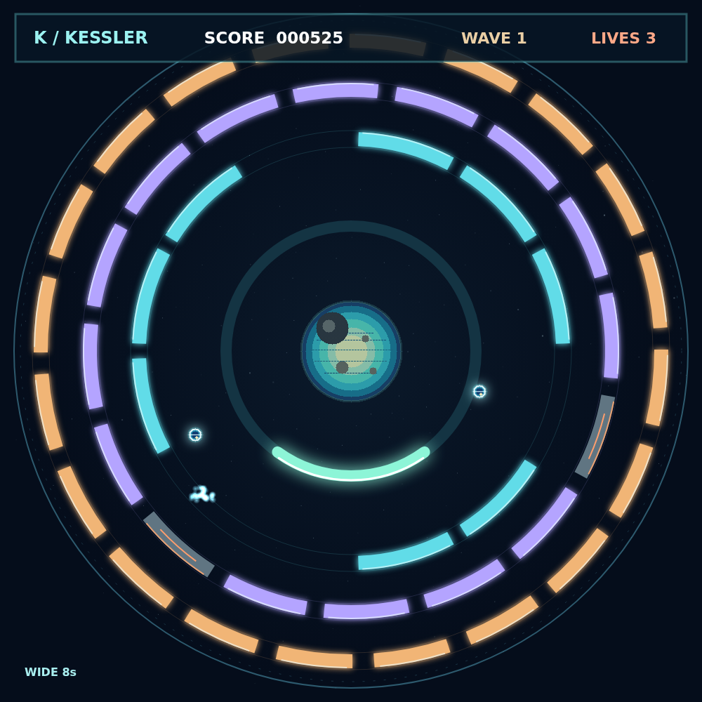
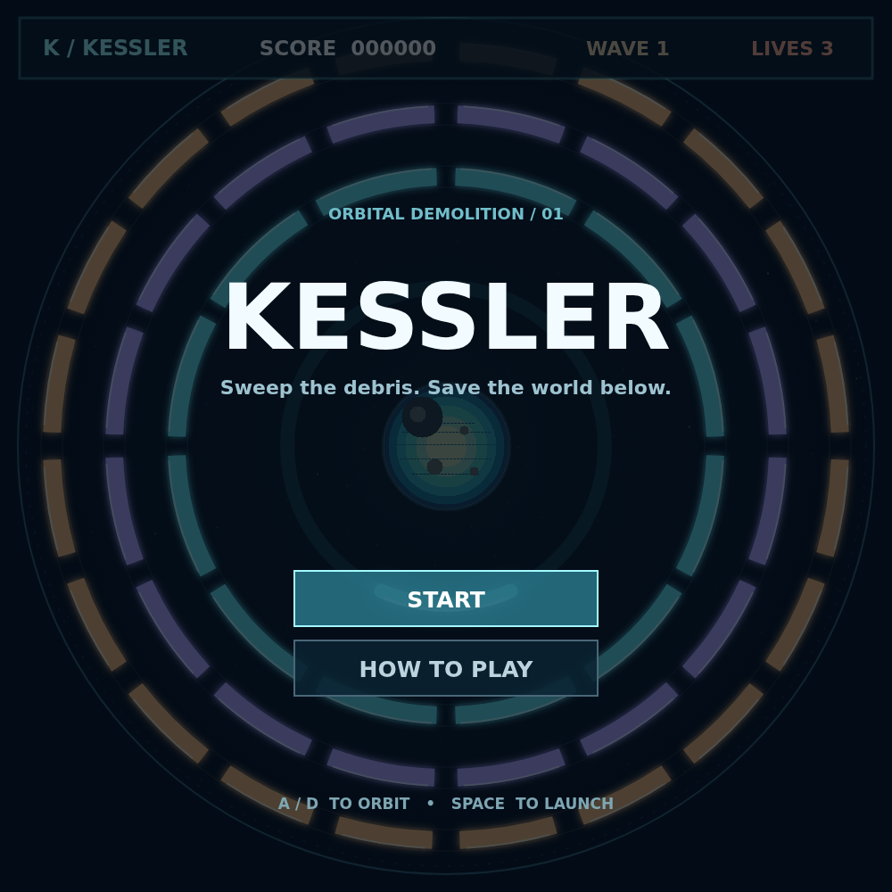

# Kessler

The planet is safe only while you keep the demolition ball in the sky. Ride your deflector around its low orbit, meet the returning ball, and send it back into the derelict rings. Where it lands on the deflector sets its next angle.

Three rings stand between you and a clean sky. The middle and outer rings turn in opposite directions, and the tougher middle targets take two hits. Sweep every target away to earn a wave bonus, then face a faster field.

A shattered satellite can shed a salvage pod. Catch one for a wider deflector, a temporary shield, piercing shots, or extra balls. One pod narrows your reach, so choose your catches as carefully as your bounces.

